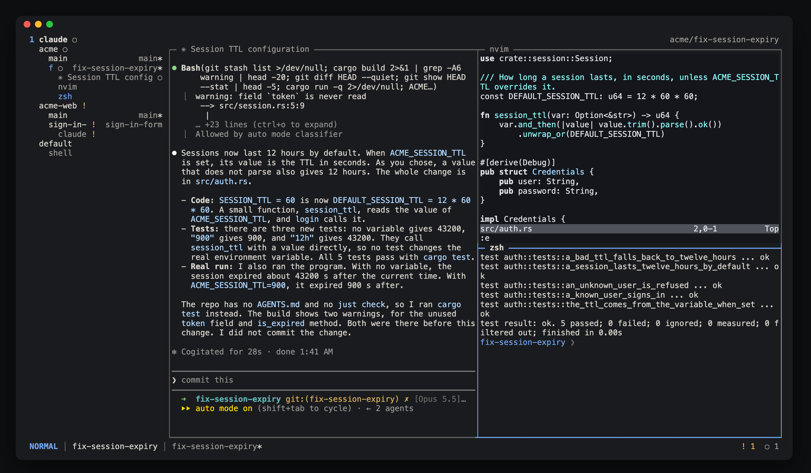
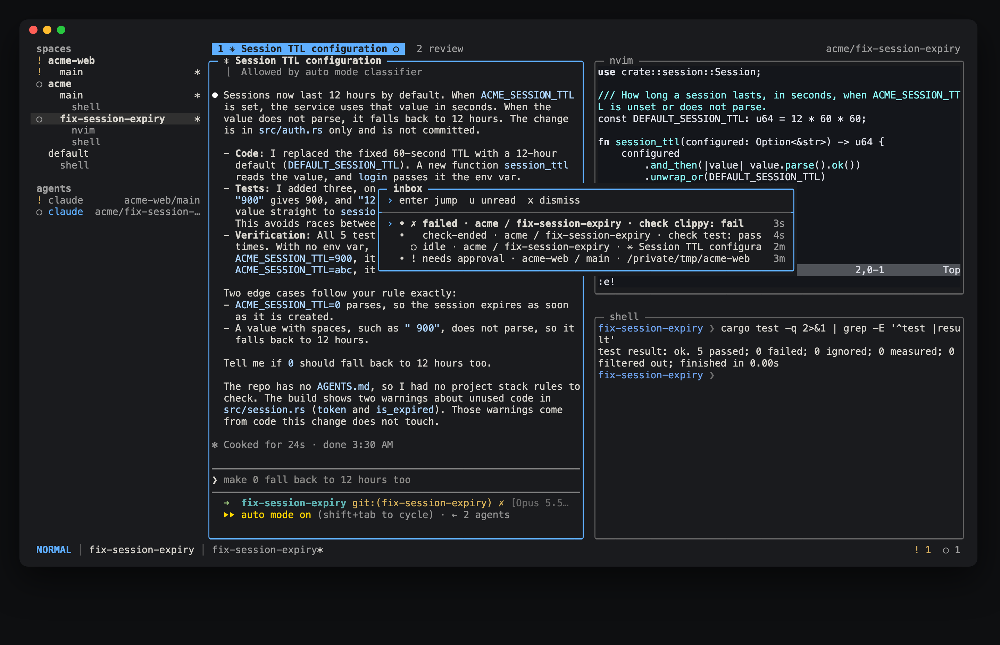
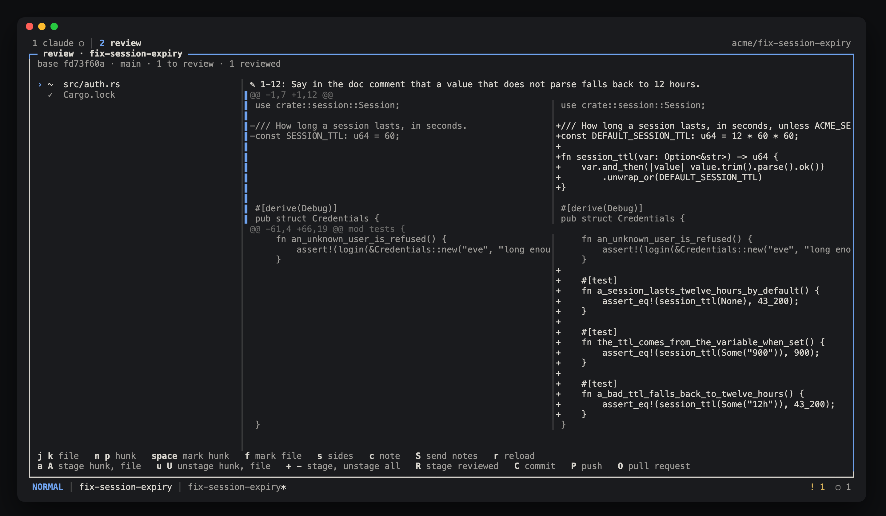

# twyx

A developer workspace: a terminal multiplexer and a native desktop app over one
persistent local daemon.

twyx runs Neovim, shells and agent CLIs unmodified, locally or over SSH. It needs
no account, no cloud, no model and no credentials.

Status: early. Version 0.1.0 is the first release.
The terminal client works. The desktop client is not ready for use.



## Install

Install the latest release on macOS or Linux, on arm64 or x86_64:

```sh
curl -fsSL https://raw.githubusercontent.com/alternayte/twyx/main/install.sh | sh
```

This puts `twyx` in `~/.local/bin`. Set `TWYX_INSTALL_DIR` to use another directory, and `TWYX_VERSION` (for example `v0.1.0`) to install one release. You need Git 2.34 or later on PATH. Review uses `git apply --cached --3way`, which older Git refuses.

To update, run the same command again. Then run `twyx daemon stop`. Your panes keep running, and the next `twyx` starts the new daemon, which adopts them.

### Build from source

You need these on PATH:

- Rust through rustup. The repository pins the toolchain, and rustup installs it on the first build.
- Zig 0.16. The terminal engine builds with it.

```sh
git clone https://github.com/alternayte/twyx.git
cd twyx
cargo install --locked --path crates/twyx
```

This puts `twyx` in `~/.cargo/bin`.

## Start

Run `twyx` in your terminal. It starts the daemon when none runs, and it attaches the TUI. In a Git repository it shows that repository's workspace. Elsewhere it shows the workspace you used last.

The prefix is `ctrl-g`. Every other key goes to the focused pane.

- `ctrl-g n` splits the pane. `ctrl-g x` closes it.
- `ctrl-g h`, `j`, `k`, `l` move the focus.
- `ctrl-g t` then `n` opens a new tab. `ctrl-g 1` to `9` go to a tab.
- `ctrl-g :` opens the palette, which finds panes and commands.
- `ctrl-g ?` shows every key, by mode. It reads your own bindings.
- `ctrl-g d` detaches. The panes keep running. Run `twyx` again to attach.
- `twyx attach <name>` attaches this terminal to a workspace by workspace name, project name, worktree, branch or path. Other clients stay where they are.
- `ctrl-g ctrl-g` sends `ctrl-g` to the pane.

[docs/keys.md](docs/keys.md) lists every key and tells you how to change them.

## Projects and worktrees

A workspace is the tabs of one Git worktree or one plain directory. twyx starts in a default workspace at your home directory.

- `twyx open <path>` opens the project that the path is in and attaches this terminal to its workspace. If the workspace is already open, it attaches to it. In a twyx pane, it shows the workspace in the client that last had input.
- `ctrl-g b` shows the sidebar: projects, worktrees, workspaces and their panes.
- `ctrl-g s` opens the workspace switcher.
- `ctrl-g w` opens workspace mode. In it, `n` makes a worktree and `x` removes one.
- `twyx ls` lists projects, worktrees and workspaces, with the branch and dirty state.
- `twyx worktree new <branch>` makes a worktree. `twyx worktree rm <branch>` removes one. Before it removes anything, it shows the changes and commits that you lose and the panes that it ends.
- `twyx recipe list` lists the recipes. `twyx recipe run <name>` opens the tabs and panes of a recipe.

Every command takes `--help`. Every command except `twyx attach` takes `--json`.

## Agents and the inbox

twyx knows Claude Code, Codex, Cursor CLI, OpenCode and Pi. It reads each agent's state from its screen, and from its hooks when you install the integration that twyx offers on the first run. The sidebar, the tabs and the status bar mark each agent: `●` working, `!` needs you, `✓` done, `○` idle, `✗` failed.

- `twyx task new --agent claude --prompt "..."` makes a worktree on a new branch and starts the agent there with the prompt. `ctrl-g w t` does the same from the TUI.
- `ctrl-g i` opens the inbox: the agents that need you, finished turns, failed panes and check results. `twyx inbox` lists it.
- twyx notifies you through your terminal when an agent needs you, except for a pane you can see.



## Review and ship

`ctrl-g v` opens the review of the worktree: every change since the branch left its base, file by file and hunk by hunk. Mark hunks reviewed, leave notes on lines, and send the notes to an agent as one paste. Then stage, commit, push and open a pull request from the same view. Commit hooks and pushes run in a pane you can watch.



`twyx review status` prints the review state, and `twyx review stage|commit|push|pr` ship from a shell.

## Checks

A check is a command, such as your tests, whose result twyx ties to the exact files it ran on. Add checks to `config.toml`, or to `.twyx/checks.toml` in a repository, which runs only after you trust it. `ctrl-g e` lists them and runs one. A result turns `stale` when the files change after it. [docs/config.md](docs/config.md) has the details.

## Automation

The daemon takes JSON requests on its socket, and `twyx events` streams changes. [docs/api.md](docs/api.md) documents the API with examples. `twyx skill` prints a skill file that teaches an agent to drive twyx.

## Configure

twyx reads `~/.config/twyx/config.toml`. A missing file means the defaults. [docs/config.md](docs/config.md) lists every setting.

## Over SSH

Install twyx on the remote host and run `twyx` there. [docs/ssh.md](docs/ssh.md) tells you how to keep panes after you log out and how to copy to your local clipboard.

## When something is wrong

- `twyx doctor` prints what your terminal supports.
- `twyx daemon status` tells you if the daemon runs.
- `twyx daemon stop` stops the daemon. The panes keep running, and the next `twyx` starts a new daemon.
- The daemon keeps its database and pane history in `~/.local/state/twyx`.

Licence: MIT.
